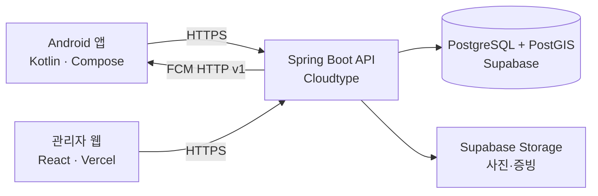

# 다시, 시흥 (Dasi Siheung)

**시흥의 빈 상가를 팝업·전시·체험 같은 단기 활동과 연결하는 공간 공유 플랫폼**

## 핵심 기능

1. **지도 기반 공간 탐색** — PostGIS 좌표로 지역을 판정하고 카카오맵에서 빈 상가를 찾습니다.
2. **신청 · 가격 협의 · 승인** — 신청서와 가격 제안·역제안으로 조건을 맞추고, 공간 제공자가 승인한 순간에만 예약이 확정됩니다. 겹치는 기간은 DB 제약으로 막습니다.
3. **2단계 신뢰 검수** — 관리자가 증빙 서류와 5개 항목을 검수하고, 공간 제공자가 신청을 최종 승인합니다.
4. **동네생활 · 소통** — 커뮤니티 게시판, 공간별 1:1 채팅, 푸시 알림(FCM)으로 창작자와 제공자를 잇습니다.

## 시스템 구성

| 서비스 | 주소 |
| --- | --- |
| Swagger UI | https://port-0-dasi-siheung-backend-mvi7gzqc5a140e65.sel3.cloudtype.app/swagger-ui.html |
| 관리자 웹 | https://dasi-siheung-web-develop.vercel.app |

## Members

| 이름 | 역할 | 담당 |
| :---: | --- | --- |
| **김예지** | 팀장 · PM, Android | 기획 총괄, 이용자 탐색·신청·커뮤니티·내 활동, 제품 검수 |
| **손유담** | UI/UX 디자인 | Figma 화면 설계, 앱 아이콘·캐릭터, 발표 자료 |
| **이우진** | Android, 관리자 웹 | 인증·공간 제공자·공통 기반, 관리자 웹, 협업 환경 |
| **원종우** | 백엔드 · DB | Spring Boot API, PostgreSQL/PostGIS, CI/CD·배포 |
| **윤원희** | QA · 릴리스 | 실기기 테스트, 버그 내역 관리, 발표 영상 |

## Repositories

| 저장소 | 설명 | 기술 |
| --- | --- | --- |
| [dasi-siheung-android](https://github.com/TUK-Mobile-Programming-1-2/dasi-siheung-android) | 이용자·공간 제공자 Android 앱 (멀티모듈 9개) | Kotlin, Compose, Hilt, Retrofit, Kakao Map SDK, FCM |
| [dasi-siheung-backend](https://github.com/TUK-Mobile-Programming-1-2/dasi-siheung-backend) | REST API 서버 | Java 21, Spring Boot 3.5, PostgreSQL + PostGIS, Flyway, JWT |
| [dasi-siheung-web](https://github.com/TUK-Mobile-Programming-1-2/dasi-siheung-web) | 운영팀용 관리자 웹 | React 19, TypeScript, Vite, Vitest |
| [dasi-siheung-docs](https://github.com/TUK-Mobile-Programming-1-2/dasi-siheung-docs) · [infra](https://github.com/TUK-Mobile-Programming-1-2/dasi-siheung-infra) | 초기 인계 문서 보관 (기획 원본은 Notion, 디자인은 Figma) | Markdown |

## Tech Stack

| 구분 | 기술 |
| --- | --- |
| App | Kotlin, Jetpack Compose, Material 3, Hilt, Coroutines, Retrofit, Coil |
| Backend · DB | Java 21, Spring Boot 3.5, Spring Security(JWT), JPA, PostgreSQL + PostGIS, Flyway |
| Web | React 19, TypeScript, Vite, React Router, Vitest |
| Infra | Supabase(DB·Storage), Cloudtype, Vercel, GitHub Actions |
| External | Kakao Map SDK, Firebase Cloud Messaging |
| Collaboration | GitHub, Notion, Figma, KakaoTalk |

© 2026 팀 김예지와 아이들 (TUK-Mobile-Programming-1-2)

